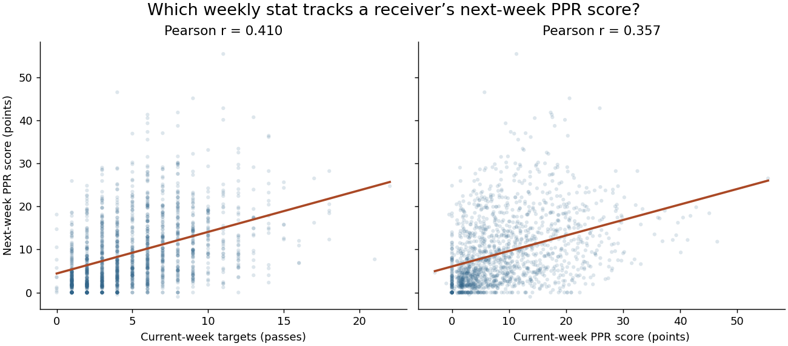

# Targets or fantasy points? Predicting next-week scoring for NFL wide receivers

**Brendan Myers**

When a receiver scores a touchdown on two targets and another draws eight targets without scoring, which performance tells a fantasy manager more about next week? Using the 2024 NFL regular season, I will compare how strongly a receiver’s targets and his PPR (points per reception) fantasy score each correlate with his PPR score the following week. Both comparisons will use the same receivers observed in consecutive weeks.

## Data

Source: [nflverse's 2024 weekly player statistics CSV](https://github.com/nflverse/nflverse-data/releases/download/player_stats/player_stats_2024.csv), collected **November 8, 2026 at 23:01:52 UTC (4:01:52 p.m. MST)** with HTTP 200. The raw file contains **5,597 records and 53 fields**. Filtering and validation produced **2,132 regular-season wide-receiver player-weeks (227 receivers)** and **1,560 consecutive-week pairs**. No selected rows were missing required values or duplicated.

The repository includes a [50-row cleaned weekly sample](data/wr_weekly_sample.csv), a [50-row matched-pair sample](data/wr_pairs_sample.csv), a [data dictionary and cleaning notes](data/README.md), [collection metadata](data/collection_metadata.json), and [cleaning output](data/cleaning_summary.json). The [executed notebook](analysis.ipynb) shows the code calls and output.

Full raw data are saved locally but excluded from Git because they include unnecessary athlete names, photo URLs, and unrelated fields. Full cleaned tables are also excluded to keep the repository focused on small examples; the scripts regenerate them. Public athlete IDs remain in the sample for matching and are linkable, not anonymous. These omissions are a data-minimization and repository-size choice, not a claim that the license forbids redistribution. Data credit: nflverse contributors, [CC BY 4.0](https://creativecommons.org/licenses/by/4.0/); the samples have been filtered and transformed as documented in the dictionary.

## Methods

I paired each receiver’s 2024 regular-season record with his record exactly one NFL week later using his player ID. Of 2,012 eligible records in weeks 1–17, 452 had no next-week observation. I left those outcomes missing. For the remaining 1,560 pairs, I calculated Pearson correlations between next-week PPR points and each of two current-week measures, targets and PPR points. Each pair counts once in both comparisons. I also grouped the same pairs by current targets and calculated their mean next-week score.

## Preliminary findings

Targets had the stronger association with next-week PPR scoring in the 2024 regular season. Across **1,560 consecutive-week pairs**, the Pearson correlation was **0.410** for current targets and **0.357** for current PPR points, a difference of **+0.053** using unrounded values. Receivers who drew eight or more targets averaged **13.94 PPR points** the following week, compared with **5.91** after three or fewer targets.

| Current-week targets | Consecutive-week pairs | Mean next-week PPR points |
| --- | ---: | ---: |
| 0–3 | 587 | 5.91 |
| 4–7 | 600 | 10.13 |
| 8 or more | 373 | 13.94 |



*Figure 1. Across 1,560 consecutive-week pairs, targets had a stronger correlation with next-week PPR points than current PPR points did, although scores varied widely around both fitted lines.*

A receiver can appear several times. The correlations combine differences between receivers with week-to-week changes in workload. They describe receivers observed in consecutive weeks during one season. Individual outcomes varied substantially even at the same target count.

## How to reproduce

Use Python 3.10 or newer. From the repository root, run:

```bash
python -m pip install -r requirements.txt
python scripts/collect.py
python scripts/clean.py
```

The collector identifies this project in its User-Agent, pauses at least two seconds between requests (including redirects), checks HTTP responses, saves the raw bytes under `data/raw/`, and records their SHA-256 checksum. It reuses an existing verified download. On a fresh clone, it downloads the source and updates the metadata; upstream revisions may change the checksum or counts from the recorded run.

Cleaning creates `data/processed/wr_weekly_2024.csv` and `data/processed/wr_consecutive_weeks_2024.csv`, plus the two committed samples and a JSON summary. Use the full generated paired table to reproduce the analysis, not the 50-row samples. No API key is required. Git ignores both full-data folders.

For the interactive version, install JupyterLab (`python -m pip install jupyterlab`), open [analysis.ipynb](analysis.ipynb) from this folder, and run all cells. Running all cells regenerates both correlations, the target-group table, and the saved figure. The committed notebook includes their outputs.
